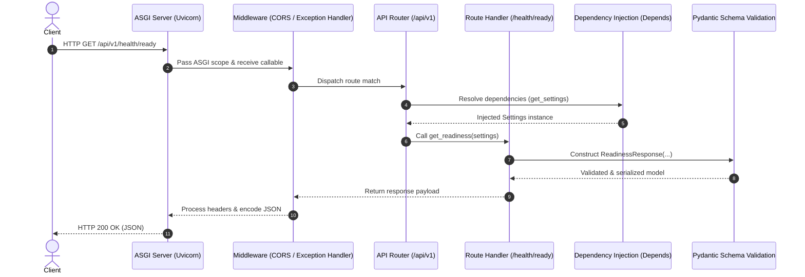

# RAGForge Architecture Overview

## 1. System Vision

RAGForge is a portfolio-grade, Small Language Model (SLM)-focused Retrieval-Augmented Generation (RAG) platform designed for verifiable, low-latency, and cost-effective retrieval workflows.

Milestone 1 establishes the production-ready FastAPI backend foundation, emphasizing:
- Strict configuration boundaries and secret isolation.
- Structured observability and logging.
- Clear separation of concerns (configuration, schemas, route controllers, services).
- Deterministic, cloud-agnostic testability without requiring live dependencies.

---

## 2. Directory Layout & Module Responsibilities

```
src/ragforge/
├── __init__.py           # Package version definition
├── main.py               # Application factory, lifespan management, global middleware
├── core/
│   ├── __init__.py
│   ├── config.py         # Centralized Pydantic Settings with env parsing and type safety
│   └── logging.py        # Structured JSON & console logging with secret sanitization
├── api/
│   ├── __init__.py
│   ├── router.py         # Central API v1 router aggregator
│   └── routes/
│       ├── __init__.py
│       └── health.py     # Liveness (/health/live) and Readiness (/health/ready) probes
├── schemas/
│   ├── __init__.py
│   └── health.py         # Strict Pydantic v2 data models for health responses
└── services/
    └── __init__.py       # Business logic / domain services (future milestones)
tests/
├── unit/
│   └── test_config.py    # Unit tests for settings, defaults, validation rules
└── integration/
    └── test_health.py    # Asynchronous endpoint tests with HTTPX
docs/
├── architecture.md       # High-level architecture and request lifecycle guide
└── decisions.md          # Architecture Decision Records (ADRs)
```

---

## 3. Request Lifecycle



### Steps in the Request Flow:
1. **ASGI Ingestion**: Uvicorn receives the raw TCP packet, completes the TLS/HTTP handshake, and passes the ASGI scope and receive/send callables.
2. **Middleware Pipeline**: The request passes through CORS origin validation (if configured) and the global exception handler context.
3. **Route Dispatch & Parameter Parsing**: FastAPI matches `/api/v1/health/ready`.
4. **Dependency Resolution**: FastAPI resolves dependency graphs via `Depends(get_settings)`. If cached via `lru_cache`, this takes microsecond execution time.
5. **Route Execution**: The handler executes asynchronously without blocking the event loop.
6. **Schema Validation & Serialization**: Return values are validated against the `response_model=ReadinessResponse`. Pydantic v2 (compiled via Rust `pydantic-core`) ensures schema conformity and eliminates unallowed fields (`extra="forbid"`).
7. **Response Delivery**: FastAPI encodes the payload to JSON and returns standard HTTP headers.

---

## 4. The Role of Dependency Injection (DI)

FastAPI's `Depends` system provides clean inversion of control:
- **Testability**: In test suites, external services or configuration objects can be mocked or swapped via `app.dependency_overrides[get_settings] = lambda: test_settings` without patching global state.
- **Resource Management**: Database sessions (`AsyncSession`), cache clients, and authentication contexts will be injected as generator dependencies (`async def get_db() -> AsyncGenerator[AsyncSession, None]: ... yield session`) in subsequent milestones.
- **Separation of Concerns**: Route handlers do not instantiate settings or connections; they receive them through their signature.

---

## 5. Security & Isolation Principles

- **No Secrets in Code or Logs**: Configuration utilizes `pydantic.SecretStr` for sensitive keys. `logging.py` explicitly strips authorization headers and tokens from contextual log payloads.
- **Safe Probes**: `/health/live` returns instantly without contacting external infrastructure. This prevents Kubernetes / Docker restart cascades during database maintenance.
- **Readiness Honesty**: `/health/ready` accurately lists `database` as `not_configured`. It never reports false availability.
- **No Stack Traces in Production**: Unhandled exceptions are caught by a custom global exception handler in `main.py`, logging the trace internally while responding with a clean, opaque `500 Internal Server Error`.
